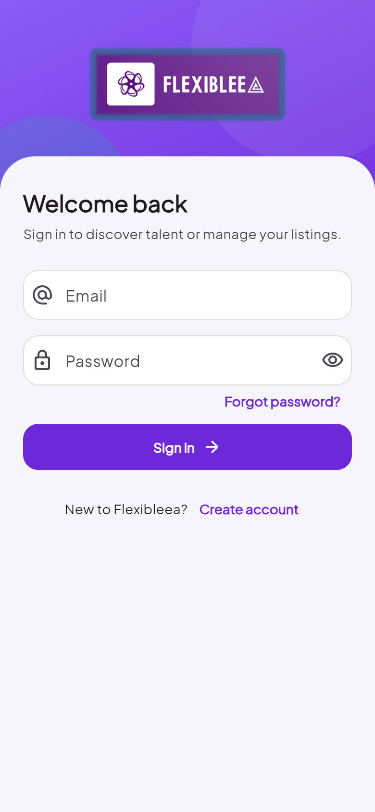
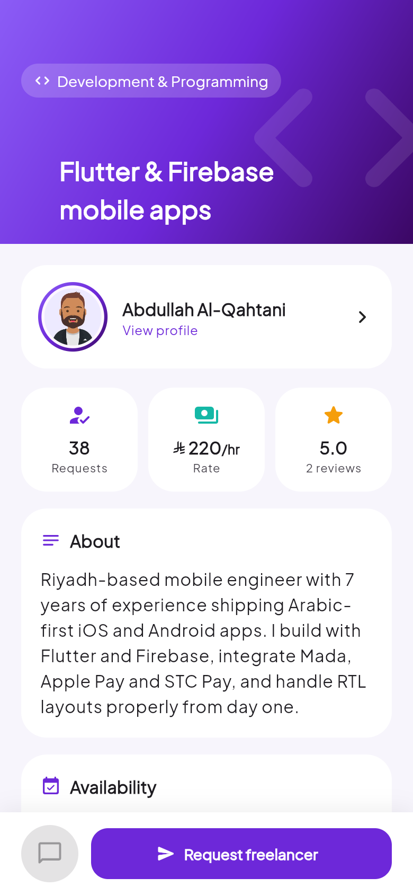
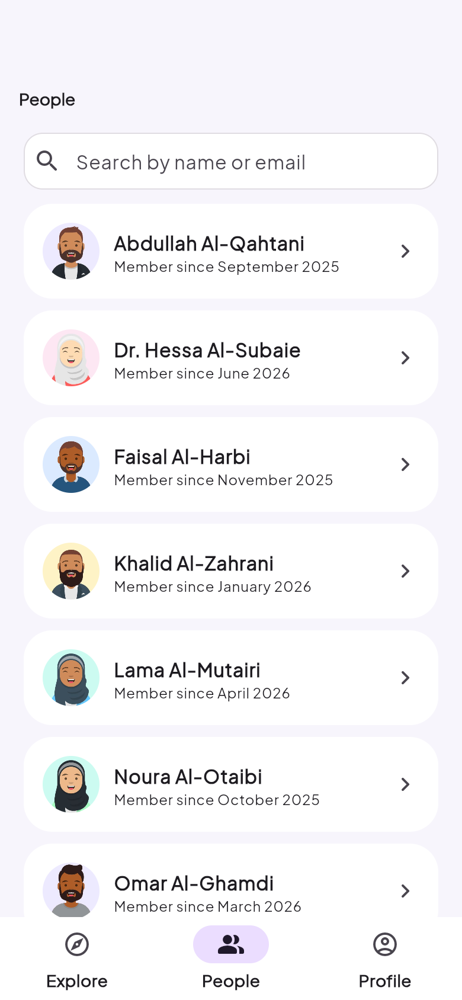
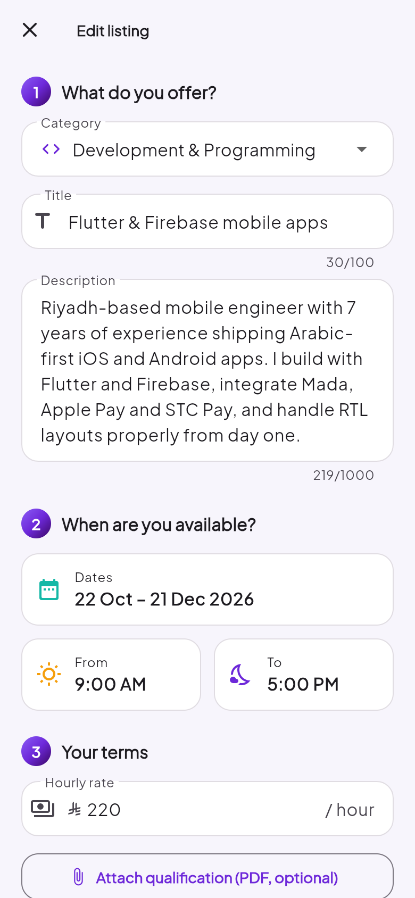
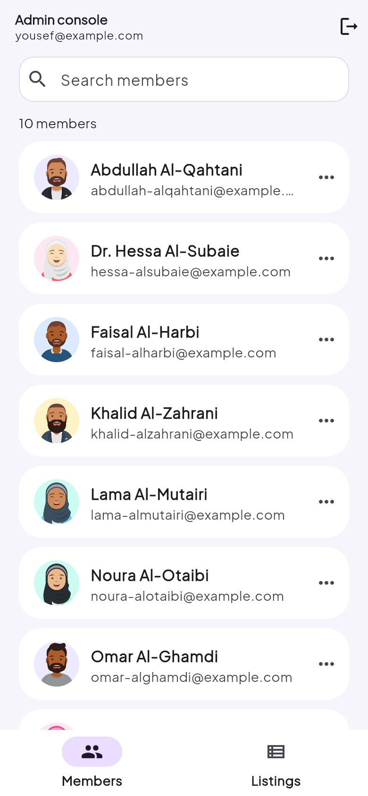
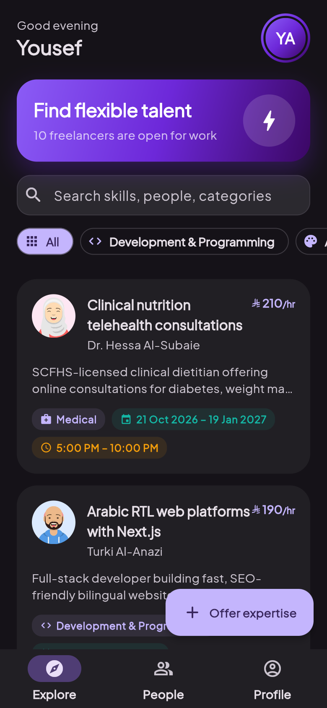

# Flexibleea

Flexibleea is a Flutter + Firebase freelancer marketplace. Freelancers publish
their expertise with their own pay rate, dates and hours. Recruiters browse,
request and review them. Admins moderate members and listings.

## Screenshots

<table>
  <tr>
    <td align="center"><br><sub>Onboarding</sub></td>
    <td align="center"><br><sub>Sign in</sub></td>
    <td align="center"><br><sub>Explore</sub></td>
  </tr>
  <tr>
    <td align="center"><br><sub>Listing details</sub></td>
    <td align="center"><br><sub>Freelancer profile</sub></td>
    <td align="center"><br><sub>People</sub></td>
  </tr>
  <tr>
    <td align="center"><br><sub>Create / edit listing</sub></td>
    <td align="center"><br><sub>Admin console</sub></td>
    <td align="center"><br><sub>Dark mode</sub></td>
  </tr>
</table>

The screenshots show the ten fictional demo freelancers from
`tool/demo/freelancers.json`, the same data that `tool/admin/demo-data.mjs seed`
writes to Firestore. Regenerate them with `tool/screenshots/capture.sh`, which
builds the real UI for the web with in-memory data and captures it in headless
Chrome.

## Features

- **Onboarding**: shown once, with a parallax illustration carousel.
- **Auth**: email sign-in and sign-up (optional cropped profile photo), password reset, and friendly error messages.
- **Explore**: a live feed of open listings, with search, category chips, shimmer loading and staggered animations.
- **Listings**:
  - Create and edit with a category, a date range, start/end times, an hourly rate and an optional qualification PDF.
  - The owner can open or pause a listing with a toggle.
  - Recruiters send a request through a prefilled email; the app counts each request.
- **Reviews**: 1–5 stars, one review per person per listing, editable. Older reviews are still displayed.
- **People and profiles**: a member directory, contact by WhatsApp, email or phone, and profile editing that updates your listings too.
- **Admin console**: rename or delete members (including their listings, reviews and photo) and remove listings.
- **Design**: Material 3 with light and dark themes, the Plus Jakarta Sans font, container-transform and shared-axis page transitions, and `flutter_animate` micro-interactions.

## Architecture

```
lib/
  main.dart / app.dart     Firebase init, providers, theme, root routing
  core/                    theme, constants, validators, formatters, errors, contact links
  models/                  AppUser, ExpertiseListing (+ ListingDraft), Review
  services/                AuthService, UserRepository, ExpertiseRepository,
                           StorageService, AdminService, Session (ChangeNotifier)
  features/                onboarding, auth, home shell, explore, people,
                           listing (details/form/reviews), profile, admin
  widgets/                 shared UI (avatar, listing card, skeletons, states...)
```

- `Session` is the single source of truth for who is signed in, their profile
  and whether they are an admin. `AuthGate` picks the root screen from it.
- Repositories only use single-field queries, so **no composite indexes are
  required**.
- Firestore field names are unchanged from earlier versions, so existing data
  keeps working (legacy placeholders and reviews are handled when reading).

### Data model

| Path | Notes |
|---|---|
| `Users/{uid}` | `id, name, email, phoneNumber, userImage, createdAt` |
| `Freelancer Expertise/{id}` | `uploadedBy, expertise (title), category, description, availableFrom/To, startTime/endTime ("HH:mm"), hourlyRate, recruitment (open), numberRequests, qualificationUrl` + owner display fields |
| `Freelancer Expertise/{id}/reviews/{reviewerUid}` | `authorId, authorName, authorImage, body, rating, createdAt` |
| Storage `userImages/{uid}.jpg` | profile photos |
| Storage `qualifications/{uid}/{listingId}.pdf` | optional PDFs |

## Security

- `firestore.rules` and `storage.rules` deny by default. Members can write only
  their own data. Others may only add exactly one to a listing's request count.
- **Admins** are Auth users with the custom claim `admin: true`. Grant it with
  [`tool/admin`](tool/admin/README.md). The old plaintext `admin/adminLogin`
  document is blocked; delete it from the console.
- Rules are covered by emulator tests in `tool/rules-test`.

## Getting started

Requirements: Flutter 3.29+ (Dart 3.7), JDK 17+, Android SDK 35, and Xcode 15.2+
with CocoaPods 1.16+ for iOS.

```bash
flutter pub get
flutter run
flutter analyze && flutter test
```

Android release signing reads `android/key.properties` (see the comment in
`android/app/build.gradle`). Without it, release builds use the debug key.

## Deploying the backend

```bash
npx firebase-tools@13 login
npx firebase-tools@13 deploy --only firestore,storage   # rules + indexes
```

Seed the demo freelancers (backs up and asks before deleting anything):

```bash
cd tool/admin && npm install
node demo-data.mjs inventory
node demo-data.mjs wipe --listings --profiles   # optional: clear existing data
node demo-data.mjs seed
```

Test the rules locally first (starts the emulators):

```bash
cd tool/rules-test && npm install && npm test
```

## Platform notes

- Android and iOS are configured for Firebase. Web, macOS, Windows and Linux are
  not; run `flutterfire configure` to add them.
- The Android application ID is still `com.example.flexibleea` because it must
  match the app registered in `google-services.json`. Register a new Android app
  in Firebase before changing it for a Play Store release.
- Rates are shown in Saudi riyals. Change `kCurrencySymbol` in `lib/core/constants.dart` for another market.
